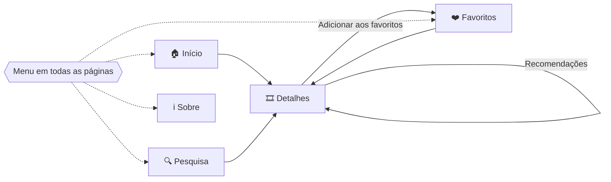
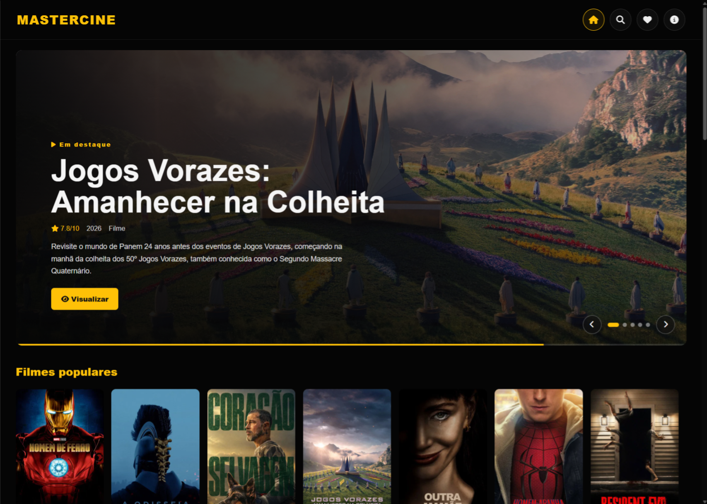
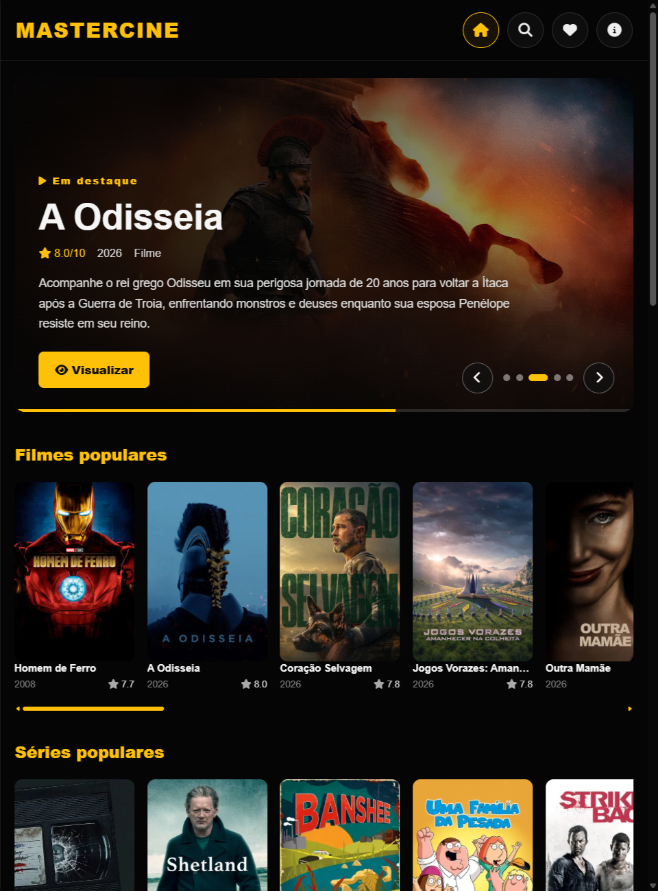
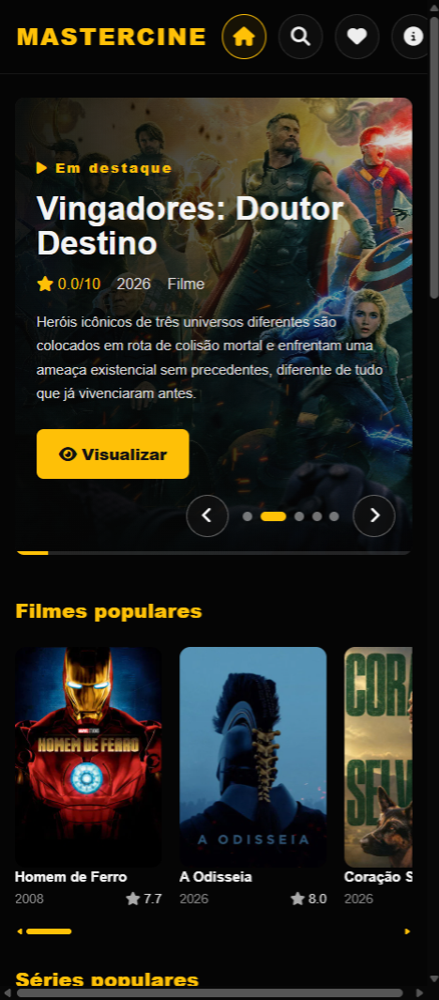

# 🎬 MasterCine

> Catálogo de filmes e séries feito com **HTML5 semântico**, **CSS3** (Flexbox, Grid, BEM e Media Queries) e **JavaScript puro**, com dados em tempo real da API do TMDB.

🔗 **Site no ar:** [mastercine-three.vercel.app](https://mastercine-three.vercel.app)


Trabalho final da disciplina **Programação Web — Web Coding** · Ciência da Computação · UNINASSAU

---

## 📌 Sumário

1. [Equipe](#-equipe)
2. [Sobre o projeto](#-sobre-o-projeto)
3. [Páginas](#-páginas)
4. [Estrutura de pastas](#-estrutura-de-pastas)
5. [HTML5 semântico e acessibilidade](#-html5-semântico-e-acessibilidade)
6. [Metodologia BEM](#-metodologia-bem)
7. [Flexbox](#-flexbox)
8. [CSS Grid Layout](#-css-grid-layout)
9. [Responsividade e Media Queries](#-responsividade-e-media-queries)
10. [Capturas de tela](#-capturas-de-tela)
11. [APIs e persistência (ponto extra)](#-apis-e-persistência-ponto-extra)
12. [Como executar](#-como-executar)

---

## 👥 Equipe

| Integrante | Responsável por |
| --- | --- |
| Valdeson Leandro | Home (`index.html`) e Detalhes (`detalhes.html`) |
| Álvaro Sollon | Pesquisa (`pesquisa.html`) e Favoritos (`favoritos.html`) |
| João Davi | Sobre (`sobre.html`) e documentação |

---

## 🎯 Sobre o projeto

O MasterCine é um catálogo no estilo das plataformas de streaming. O usuário pode:

- ver os títulos em alta num banner rotativo e navegar por 7 categorias;
- pesquisar qualquer filme ou série pelo nome;
- abrir a ficha completa de um título (sinopse, elenco, trailer, orçamento, bilheteria e recomendações);
- em séries, escolher a temporada e ver a lista de episódios;
- assistir pelo player integrado;
- salvar favoritos, que continuam lá mesmo depois de fechar o navegador.

Nenhum filme está escrito no código: todos os dados vêm da API do TMDB no momento em que a página abre.

---

## 📄 Páginas

O site tem **5 páginas HTML** ligadas pelo mesmo menu. A página atual fica marcada com a classe `cabecalho__link--ativo` e com `aria-current="page"`.

| Página | Arquivo | O que tem |
| --- | --- | --- |
| Início | `index.html` | Banner com os 5 títulos em alta da semana (troca a cada 6 s) e 7 trilhos de categorias: Filmes populares, Séries populares, Terror, Ação e aventura, Animação, Ficção científica e Lançamentos |
| Detalhes | `detalhes.html` | Hero com backdrop, pôster, nota, gêneros e sinopse; botões **Assistir** e **Adicionar aos favoritos**; temporadas e episódios (séries); trailer; elenco em carrossel; orçamento e bilheteria; recomendações |
| Pesquisa | `pesquisa.html` | Busca por nome (filmes e séries juntos) com resultados em grade |
| Favoritos | `favoritos.html` | Títulos salvos no navegador, com botão de remover e mensagem quando a lista está vazia |
| Sobre | `sobre.html` | Objetivo do projeto, recursos e tecnologias |



A página de Detalhes é uma só para qualquer título: o ID e o tipo vão na URL (`detalhes.html?id=550&type=movie`) e o JavaScript busca os dados correspondentes.

---

## 📁 Estrutura de pastas

```text
mastercine/
├── css/
│   ├── style.css       # estilos globais: cabeçalho, banner, trilhos, pesquisa, rodapé e media queries
│   ├── detalhes.css    # página de detalhes, episódios, elenco e modal do player
│   ├── favoritos.css   # grade de favoritos e estado vazio
│   └── sobre.css       # página Sobre
├── js/
│   ├── app.js          # Home: banner rotativo e categorias
│   ├── detalhes.js     # Detalhes: dados do título, temporadas, player e botão de favoritos
│   ├── pesquisa.js     # Pesquisa: busca na API e renderização dos resultados
│   └── favoritos.js    # Favoritos: leitura, renderização e remoção
├── img/
│   └── screenshots/    # capturas em 1366, 768 e 375 px
├── index.html
├── detalhes.html
├── pesquisa.html
├── favoritos.html
├── sobre.html
└── README.md
```

Todo o CSS é externo. Cada página carrega o `style.css` global e, quando precisa, o seu CSS próprio.

---

## 🧱 HTML5 semântico e acessibilidade

Todas as páginas seguem a mesma estrutura:

```html
<header class="cabecalho">      <!-- logo + menu -->
  <nav class="cabecalho__navegacao" aria-label="Navegação principal">…</nav>
</header>
<main>…</main>                  <!-- conteúdo da página, dividido em <section> -->
<footer class="rodape">…</footer>
```

| Elemento | Onde aparece |
| --- | --- |
| `<header>` e `<nav>` | Cabeçalho e menu de todas as páginas; cabeçalho do modal do player |
| `<main>` | Conteúdo principal de cada página |
| `<section>` | Banner, cada categoria da Home, temporadas, trailer, elenco, desempenho, recomendações e blocos do Sobre |
| `<article>` | Cards de filmes e séries, de episódios, de atores e de favoritos |
| `<footer>` | Rodapé de todas as páginas e créditos do TMDB na página Sobre |

Recursos de acessibilidade usados:

- `aria-label` nos ícones do menu e no campo de pesquisa;
- `aria-current="page"` no item ativo do menu;
- `aria-live="polite"` nos resultados da pesquisa e na lista de favoritos, para o leitor de tela anunciar mudanças;
- `aria-pressed` no botão de favoritar;
- modal do player com `role="dialog"` e `aria-modal="true"`, que fecha com **Esc**, no **X** ou clicando fora;
- cards com `tabindex="0"` que abrem com **Enter** ou **Espaço**;
- `:focus-visible` global com contorno amarelo (`style.css`) e `alt` em todas as imagens.

---

## 🏷️ Metodologia BEM

As classes seguem o padrão **bloco**, **bloco__elemento** e **bloco--modificador**.

| Bloco | Elementos | Modificadores |
| --- | --- | --- |
| `cabecalho` | `__logo`, `__navegacao`, `__menu`, `__item`, `__link` | `cabecalho__link--ativo` |
| `catalogo-card` | `__poster`, `__textos`, `__titulo`, `__dados`, `__ano`, `__avaliacao` | `--movie`, `--tv`, `--resultado`, `--recomendacao` |
| `detalhe` | `__hero`, `__poster`, `__titulo`, `__meta`, `__generos`, `__sinopse`, `__acoes`, `__btn` | `detalhe__btn--principal`, `detalhe__btn--favorito`, `detalhe-btn--favorito-ativo` |
| `favorito-card` | `__link`, `__poster`, `__titulo`, `__dados`, `__ano`, `__avaliacao`, `__remover` | — |
| `favoritos-grid` | — | `favoritos-grid--vazio` |
| `player-modal` | `__backdrop`, `__dialogo`, `__cabecalho`, `__titulos`, `__titulo`, `__subtitulo`, `__fechar`, `__corpo`, `__iframe` | — |
| `rodape` | `__texto`, `__aviso` | — |

Exemplo real do card da Home (`js/app.js`):

```html
<article class="catalogo-card catalogo-card--movie" tabindex="0" role="button">
  <div class="catalogo-card__poster"></div>
  <div class="catalogo-card__textos">
    <div class="catalogo-card__titulo">Interestelar</div>
  </div>
  <div class="catalogo-card__dados">
    <span class="catalogo-card__ano">2014</span>
    <span class="catalogo-card__avaliacao">★ 8.4</span>
  </div>
</article>
```

> **Observação:** algumas classes da primeira versão (`.header`, `.filme`, `.serie`, `.ativo`, `.hidden`) foram mantidas junto das classes BEM porque os scripts ainda as usam. Isso está comentado no `style.css`.

---

## ↔️ Flexbox

O Flexbox organiza os alinhamentos em uma direção. Todas as propriedades pedidas no trabalho aparecem: `display: flex`, `flex-direction`, `justify-content`, `align-items`, `flex-wrap` e `gap`.

| Área | Arquivo · seletor | Propriedades |
| --- | --- | --- |
| Estrutura da página (rodapé sempre embaixo) | `style.css` · `.container-principal` | `display: flex`, `flex-direction: column` |
| Cabeçalho: logo de um lado, menu do outro | `style.css` · `.cabecalho` | `justify-content: space-between`, `align-items: center`, `gap: 24px` |
| Menu de navegação | `style.css` · `.header-menu` / `.cabecalho__menu` | `align-items: center`, `justify-content: flex-end`, `gap: 10px` |
| Trilhos de cards da Home (rolagem lateral) | `style.css` · `.filmes-container`, `.series-container` | `flex-wrap: nowrap`, `gap: 15px`, `overflow-x: auto`, `scroll-snap-type` |
| Linha de ano e nota dos cards | `style.css` · `.card-dados` | `justify-content: space-between`, `align-items: center` |
| Rodapé | `style.css` · `.rodape` | `flex-direction: column`, `align-items: center` |
| Barra de pesquisa | `style.css` · `.pesquisa-form` | `align-items: center`, `gap: 12px`; input com `flex: 1` |
| Hero dos detalhes (pôster + textos) | `detalhes.css` · `.detalhe__hero-conteudo` | `align-items: flex-end`, `gap: 32px` |
| Botões Assistir e Favoritos | `detalhes.css` · `.detalhe__acoes` | `flex-wrap: wrap`, `align-items: center`, `gap: 10px` |
| Lista de episódios | `detalhes.css` · `.lista-episodios` | `flex-direction: row`, `gap: 16px`, `overflow-x: auto` |
| Ano e nota dos favoritos | `favoritos.css` · `.favorito-card__dados` | `justify-content: space-between` |

---

## 🔲 CSS Grid Layout

O Grid organiza os cards em linhas e colunas ao mesmo tempo.

| Área | Arquivo · seletor | Propriedades |
| --- | --- | --- |
| Resultados da pesquisa (até 20 cards) | `style.css` · `.pesquisa-grid` | `display: grid`, `grid-template-columns: repeat(auto-fit, minmax(135px, 1fr))`, `gap: 22px 16px` |
| Grade de favoritos | `favoritos.css` · `.favoritos-grid` | `grid-template-columns: repeat(auto-fill, minmax(145px, 1fr))`, `gap: 22px 16px` |
| Mensagem de lista vazia (posicionamento explícito) | `favoritos.css` · `.favoritos-vazio` | `grid-column: 1 / -1`, ocupa da primeira à última coluna |
| Lista de recursos do Sobre | `sobre.css` · `.sobre-lista` | `grid-template-columns: repeat(2, minmax(0, 1fr))`, `gap: 11px 35px` |

```css
/* style.css: o navegador calcula quantas colunas cabem */
.pesquisa-grid {
  display: grid;
  grid-template-columns: repeat(auto-fit, minmax(135px, 1fr));
  gap: 22px 16px;
}

/* favoritos.css: a mensagem ocupa a linha inteira da grade */
.favoritos-vazio {
  grid-column: 1 / -1;
}
```

---

## 📱 Responsividade e Media Queries

O site foi testado em **375 px** (celular), **768 px** (tablet) e **1366 px** (computador), sem rolagem horizontal, textos cortados ou elementos sobrepostos.

| Arquivo | Breakpoints | O que muda |
| --- | --- | --- |
| `style.css` | `min-width: 769px` · `max-width: 768px` · `max-width: 480px` | Margens do cabeçalho e do conteúdo, altura do banner, tamanho dos cards nos trilhos (155 → 140 px) e pesquisa com **2 colunas** no celular |
| `detalhes.css` | `min-width: 769px` · `max-width: 768px` · `max-width: 480px` | Hero passa de linha para **coluna** (`flex-direction: column`), pôster centralizado, botões com largura total, cabeçalho das temporadas em coluna e modal do player ajustado |
| `favoritos.css` | `max-width: 768px` · `max-width: 480px` | Cards menores (mínimo de 130 px) e **2 colunas fixas** no celular |
| `sobre.css` | `max-width: 768px` · `max-width: 480px` | Lista de recursos passa de 2 colunas para **1 coluna**, fontes e espaçamentos menores |

Outros cuidados: `meta viewport` em todas as páginas, `clamp()` nos títulos, `aspect-ratio` em pôsteres e vídeos (2:3 e 16:9) e `img { max-width: 100% }`.

---

## 🖼️ Capturas de tela

| Computador (1366 px) | Tablet (768 px) | Celular (375 px) |
| :---: | :---: | :---: |
|  |  |  |

---

## 🔌 APIs e persistência (ponto extra)

### TMDB (The Movie Database)

Todos os dados vêm da API v3 do TMDB, em português (`language=pt-BR`). As chamadas de cada página são feitas em paralelo com `Promise.all`.

| Uso | Endpoint |
| --- | --- |
| Banner (em alta na semana) | `/trending/all/week` |
| Categorias da Home | `/movie/popular`, `/tv/popular`, `/movie/now_playing`, `/discover/movie` (por gênero) |
| Pesquisa | `/search/multi` |
| Ficha do título | `/{movie ou tv}/{id}` |
| Elenco, trailer e recomendações | `/credits`, `/videos`, `/recommendations` |
| Episódios de uma temporada | `/tv/{id}/season/{número}` |

Os trailers são exibidos pelo `youtube-nocookie.com`.

### Player (MyEmbed)

O endereço do player fica centralizado no objeto `PLAYER_API`, em `js/detalhes.js`:

```js
const PLAYER_API = {
  filme: (tmdbId) => `https://myembed.biz/filme/${tmdbId}`,
  serie: (tmdbId, season, episode) => `https://myembed.biz/serie/${tmdbId}/${season}/${episode}`,
};
```

- **Filme:** o botão **Assistir** abre o modal com o filme.
- **Série:** o botão **Assistir** abre o primeiro episódio da temporada escolhida no seletor, e cada card de episódio abre o player direto naquele episódio.

### LocalStorage

| Chave | O que guarda |
| --- | --- |
| `mastercine_favoritos` | Lista em JSON com `id`, `type`, `title`, `poster`, `year` e `vote_average` de cada favorito |
| `mastercine_tmdb_api_key` | Chave da API do TMDB informada pelo usuário |

O botão de favoritar fica na página de Detalhes e alterna entre **Adicionar** e **Remover dos favoritos**. A página Favoritos lê a mesma chave, e a leitura usa `try/catch` para não quebrar caso o JSON esteja corrompido.

### Segurança

Todo texto que vem da API passa pela função `escapeHTML` antes de entrar no HTML, para evitar a execução de código malicioso (XSS).

---

## ▶️ Como executar

**Online:** acesse [mastercine-three.vercel.app](https://mastercine-three.vercel.app).

**Localmente:**

1. Clone o repositório:
   ```bash
   git clone https://github.com/yjtank/mastercine.git
   cd mastercine
   ```
2. Abra a pasta no VS Code e rode o `index.html` com a extensão **Live Server** (ou abra o arquivo direto no navegador).
3. No primeiro acesso, o site pede a **chave da API v3 do TMDB**. Ela pode ser criada de graça em [themoviedb.org](https://www.themoviedb.org/settings/api) e fica salva no navegador.

---

<p align="center">
  Este produto utiliza a API do TMDB, mas não é endossado ou certificado pelo TMDB.<br>
  © 2026 MasterCine
</p>
